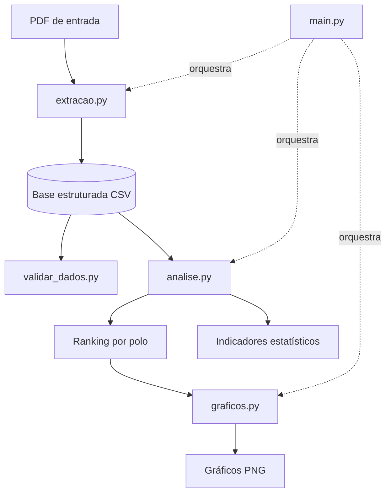

# Análise de Inscrições --- IFCE

Pipeline em Python que transforma uma lista de inscrições deferidas,
publicada em PDF, em uma base tabular validada, com indicadores
estatísticos e visualizações reproduzíveis a partir de um único comando.


## Sumário

-   [Visão geral](#visão-geral)
-   [Principais resultados](#principais-resultados)
-   [Arquitetura](#arquitetura)
-   [Stack](#stack)
-   [Estrutura do repositório](#estrutura-do-repositório)
-   [Como executar](#como-executar)
-   [Análise dos resultados](#análise-dos-resultados)
-   [Qualidade dos dados](#qualidade-dos-dados)
-   [Visualizações](#visualizações)
-   [Privacidade e conformidade](#privacidade-e-conformidade)
-   [Limitações e roadmap](#limitações-e-roadmap)
-   [Autor](#autor)

## Visão geral

**Problema.** A lista de inscrições é divulgada em PDF, formato que
dificulta filtrar, agregar e comparar os registros sem antes estruturar
os dados.

**Solução.** Um pipeline modular que extrai os registros do PDF,
estrutura-os em uma base tabular, valida aspectos da integridade dos
dados, calcula o ranking e indicadores por polo e gera gráficos.

**Escopo**

-   Extração de registros de PDF com PyMuPDF.
-   Estruturação em colunas: protocolo, nome, curso, polo e situação.
-   Validação de integridade: campos obrigatórios, formato de protocolo
    e duplicidades.
-   Ranking e indicadores estatísticos por polo.
-   Geração automatizada de gráficos em PNG.

## Principais resultados

Na execução de referência, o pipeline processou **743 inscrições
deferidas em 6 polos**.

  Indicador                                     Resultado
  -------------------------------- ----------------------
  Inscrições deferidas                                743
  Polos identificados                                   6
  Maior polo --- Fortaleza                   307 (41,32%)
  Três maiores polos                         555 (74,70%)
  Média por polo                                   123,83
  Mediana por polo                                   93,5
  Razão entre maior e menor polo     Aproximadamente 6,3×

> Os valores refletem o documento utilizado durante o desenvolvimento e
> podem mudar conforme o PDF de entrada.

## Arquitetura

Cada etapa é organizada em módulos com responsabilidades distintas. O
`main.py` orquestra a extração, a análise e a geração dos gráficos. A
validação é executada separadamente.



  -----------------------------------------------------------------------
  Módulo                              Responsabilidade
  ----------------------------------- -----------------------------------
  `extracao.py`                       Lê o PDF com PyMuPDF, identifica os
                                      registros e gera um DataFrame

  `validar_dados.py`                  Verifica campos obrigatórios,
                                      formato dos protocolos,
                                      duplicidades e distribuição de
                                      situações e polos

  `analise.py`                        Filtra inscrições deferidas, agrega
                                      por polo, ordena o ranking e
                                      calcula indicadores

  `graficos.py`                       Gera visualizações a partir do
                                      resumo da análise

  `main.py`                           Executa extração, análise e geração
                                      de gráficos em sequência
  -----------------------------------------------------------------------

**Decisão de projeto:** a validação roda de forma independente do
`main.py`. Isso permite verificar a base gerada sem reprocessar o
pipeline completo.

## Stack

  Tecnologia     Uso
  -------------- ---------------------------------------------
  Python         Linguagem principal
  Pandas         Estruturação, agregação e análise
  PyMuPDF        Extração de texto do PDF
  Matplotlib     Visualizações
  OpenPyXL       Dependência incluída no ambiente do projeto
  Git e GitHub   Versionamento e hospedagem

## Estrutura do repositório

``` text
analise-inscricoes-ifce/
├── dados/                  # Entradas locais (fora do versionamento)
├── resultados/             # CSVs, indicadores e gráficos gerados localmente
├── extracao.py             # Extração estruturada do PDF
├── validar_dados.py        # Verificações de qualidade
├── analise.py              # Ranking e indicadores
├── graficos.py             # Visualizações
├── main.py                 # Orquestração do pipeline
├── teste_extracao.py       # Verificação da extração
├── teste_analise.py        # Verificação da análise
├── teste_graficos.py       # Verificação dos gráficos
├── requirements.txt
├── .gitignore
└── README.md
```

As pastas `dados/` e `resultados/` são utilizadas localmente e estão
excluídas do versionamento para evitar a publicação acidental de
documentos de origem ou bases que possam conter informações pessoais.

## Como executar

### Pré-requisitos

-   Python 3 instalado.
-   Um documento PDF compatível com o padrão esperado pelo extrator.
-   Git, caso queira clonar o repositório.

### 1. Clonar o repositório

``` bash
git clone https://github.com/pedrombz/analise-inscricoes-ifce.git
cd analise-inscricoes-ifce
```

### 2. Criar o ambiente virtual

No Windows:

``` powershell
python -m venv .venv
```

### 3. Ativar o ambiente virtual

``` powershell
.\.venv\Scripts\Activate.ps1
```

Se o PowerShell bloquear a ativação, você pode executar diretamente o
interpretador do ambiente virtual, sem ativá-lo.

### 4. Instalar as dependências

``` powershell
python -m pip install -r requirements.txt
```

### 5. Adicionar o documento de entrada

Coloque o PDF esperado pelo projeto na pasta `dados/`, mantendo o nome e
o caminho configurados no código:

``` text
dados/Lista das inscrições deferidas.pdf
```

O documento original não é distribuído pelo repositório.

### 6. Executar o pipeline

``` powershell
python main.py
```

Essa etapa extrai os dados, salva a base estruturada, calcula os
indicadores e gera os gráficos em `resultados/`.

### 7. Validar a base

``` powershell
python validar_dados.py
```

A validação é independente e pode ser executada após a extração. A saída
apresenta verificações de integridade e um resumo quantitativo, sem
listar nomes ou protocolos individualmente.

## Análise dos resultados

### Distribuição por polo

    Posição Polo                     Inscrições   Participação
  --------- ---------------------- ------------ --------------
          1 Fortaleza                       307         41,32%
          2 Maracanaú                       132         17,77%
          3 Itapipoca                       116         15,61%
          4 Horizonte                        71          9,56%
          5 Caucaia Novo Pabussu             68          9,15%
          6 Maranguape                       49          6,59%
            **Total**                   **743**       **100%**

### Estatísticas descritivas

  Indicador                             Resultado
  ----------------------------------- -----------
  Média por polo                           123,83
  Mediana por polo                           93,5
  Maior volume                                307
  Menor volume                                 49
  Amplitude                                   258
  Inscrições nos três maiores polos           555
  Participação dos três maiores            74,70%

### Leitura dos dados

-   **Concentração:** Fortaleza responde por cerca de quatro em cada dez
    inscrições. Os três maiores polos somam quase 75% do total; os
    outros três reúnem 188 inscrições.
-   **Média e mediana:** a média (123,83) supera a mediana (93,5), o que
    é compatível com a influência do volume de Fortaleza sobre a média.
-   **Dispersão:** a diferença entre o maior e o menor polo é de 258
    registros. O volume de Fortaleza é aproximadamente 6,3 vezes o de
    Maranguape.

**Ressalva metodológica:** os números são contagens absolutas. Sem
informações sobre vagas ofertadas, total de inscritos, população
atendida ou candidatos por vaga, não é possível inferir demanda relativa
nem explicar as causas da concentração.

## Qualidade dos dados

Resultado da validação na execução de referência:

  Verificação                                Resultado
  ---------------------------------------- -----------
  Registros analisados                             743
  Campos obrigatórios vazios                         0
  Protocolos duplicados                              0
  Protocolos fora do padrão esperado                 0
  Situações identificadas como deferidas           743
  Polos distintos não vazios                         6

A validação é estrutural e **não substitui a conferência do conteúdo
extraído contra o PDF original**. A confiabilidade também depende do
layout do documento e da correta identificação de cada registro.

## Visualizações

Os gráficos são gerados localmente em `resultados/` e não são
versionados. Para exibi-los no GitHub, inclua cópias autorizadas e sem
dados pessoais em uma pasta pública, como `docs/`, e referencie os
arquivos no README.

Exemplo de inclusão de um gráfico:

``` markdown

```

O caminho só funcionará depois que o arquivo correspondente for
adicionado ao repositório.

## Privacidade e conformidade

O PDF de origem pode conter nomes, protocolos e outros dados pessoais.
Por isso:

-   `dados/` e `resultados/` estão no `.gitignore`.
-   O PDF original e os CSVs com dados pessoais não devem ser publicados
    sem autorização.
-   Resultados agregados só devem ser divulgados quando houver
    autorização para isso.
-   O `.gitignore` evita inclusões acidentais, mas não remove arquivos
    que já tenham sido enviados ao Git.

A publicação deve respeitar as regras de acesso, confidencialidade e
proteção de dados aplicáveis à fonte.

## Limitações e roadmap

### Limitações atuais

-   O extrator depende do padrão de layout do PDF esperado.
-   A validação não compara automaticamente o total extraído com os
    totais declarados no documento.
-   Os resultados descrevem a distribuição dos registros e não explicam,
    por si só, as causas das diferenças entre os polos.

### Próximos passos

-   [ ] Migrar os testes para `pytest`.
-   [ ] Suportar diferentes layouts de PDF.
-   [ ] Registrar em log os registros que não puderam ser extraídos.
-   [ ] Reconciliar automaticamente o total extraído com o total do
    documento.
-   [ ] Exportar tabelas e indicadores em formato padronizado.
-   [ ] Publicar gráficos de exemplo no README.
-   [ ] Configurar integração contínua para executar os testes a cada
    alteração.

## Autor

Projeto de portfólio em Python, análise de dados, automação e construção
de pipelines.

**GitHub:** [pedrombz](https://github.com/pedrombz)

------------------------------------------------------------------------

*Projeto de portfólio. Os resultados referem-se à execução descrita
nesta documentação e não constituem avaliação causal ou institucional
dos polos.*
