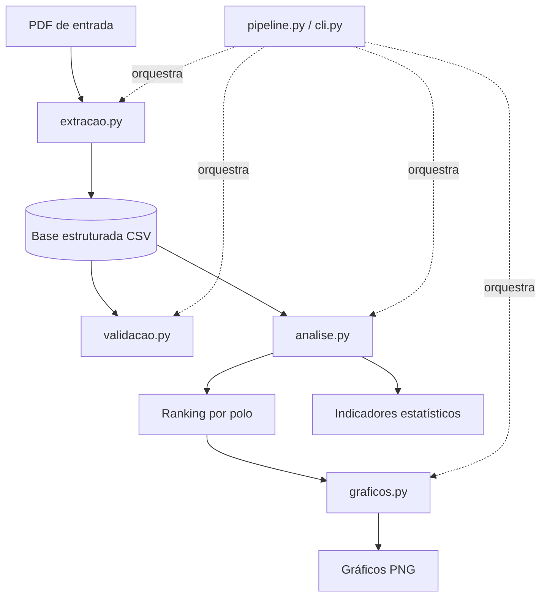
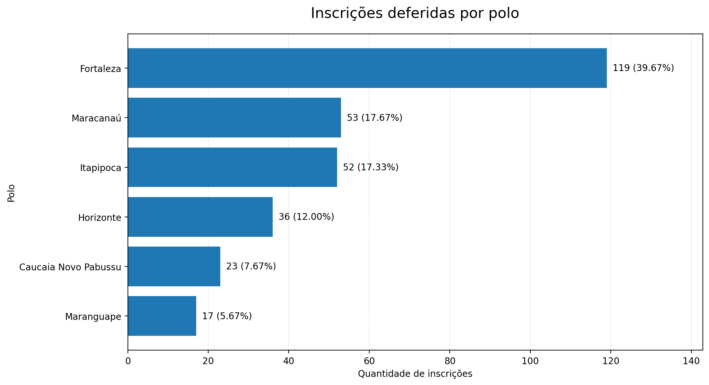
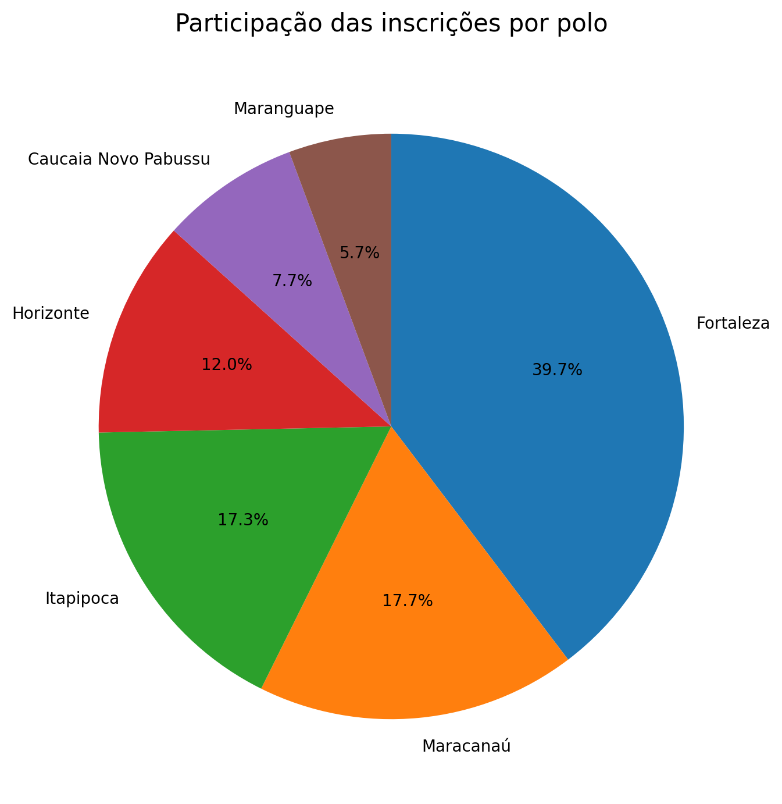

# Análise de Inscrições — IFCE

Pipeline em Python que transforma uma lista de inscrições deferidas, publicada em PDF, em uma
base tabular validada, com indicadores estatísticos e visualizações reproduzíveis a partir de
um único comando.


## Sumário

- [Visão geral](#visão-geral)
- [Teste rápido sem dados reais](#teste-rápido-sem-dados-reais)
- [Principais resultados](#principais-resultados)
- [Arquitetura](#arquitetura)
- [Estrutura do repositório](#estrutura-do-repositório)
- [Como executar](#como-executar)
- [Testes](#testes)
- [Análise dos resultados](#análise-dos-resultados)
- [Qualidade dos dados](#qualidade-dos-dados)
- [Visualizações](#visualizações)
- [Privacidade e conformidade](#privacidade-e-conformidade)
- [Limitações e roadmap](#limitações-e-roadmap)
- [Licença](#licença)

## Visão geral

**Problema.** A lista de inscrições é divulgada em PDF, formato que dificulta filtrar, agregar
e comparar os registros sem antes estruturar os dados.

**Fonte dos dados.** Lista pública de inscrições deferidas divulgada pelo IFCE, disponível em
<https://qselecao.ifce.edu.br/download.aspx?cod_arquivo_download=74835>.

**Solução.** Um pipeline modular que extrai os registros do PDF, estrutura-os em uma base
tabular, valida a integridade, calcula ranking e indicadores por polo e gera gráficos.

**Escopo**

- Extração de registros de PDF com PyMuPDF, com contagem de controle (protocolos encontrados
  × registros extraídos) e aviso quando algum protocolo é descartado.
- Estruturação em colunas: protocolo, nome, curso, polo e situação.
- Validação de integridade: campos obrigatórios, formato de protocolo, duplicidades e
  distribuição de situações e polos.
- Ranking e indicadores estatísticos por polo, exportados em CSV.
- Geração automatizada de gráficos em PNG.
- Testes automatizados e CI, com um gerador de PDF sintético para rodar tudo sem dados pessoais.

## Teste rápido sem dados reais

Não é preciso ter o PDF original. O projeto gera um PDF **sintético** (nomes e protocolos
fictícios) no mesmo formato esperado pelo extrator:

```bash
python main.py exemplo                                   # cria dados/exemplo_sintetico.pdf
python main.py executar --pdf dados/exemplo_sintetico.pdf --validar
```

## Principais resultados

Na execução de referência, o pipeline processou **743 inscrições deferidas em 6 polos**.

| Indicador | Resultado |
| --- | --- |
| Inscrições deferidas | 743 |
| Polos identificados | 6 |
| Maior polo — Fortaleza | 307 (41,32%) |
| Três maiores polos | 555 (74,70%) |
| Média por polo | 123,83 |
| Mediana por polo | 93,5 |
| Razão entre maior e menor polo | aproximadamente 6,3× |

> Os valores refletem o documento utilizado durante o desenvolvimento e podem mudar conforme
> o PDF de entrada. Estes números também são reproduzidos em `tests/test_analise.py`.

## Arquitetura



| Módulo | Responsabilidade |
| --- | --- |
| `inscricoes/extracao.py` | Lê o PDF com PyMuPDF, identifica os registros e devolve um DataFrame com contagem de controle |
| `inscricoes/validacao.py` | Verifica campos obrigatórios, formato dos protocolos, duplicidades e distribuição de situações e polos |
| `inscricoes/analise.py` | Filtra inscrições deferidas, agrega por polo, ordena o ranking (desempate determinístico) e calcula indicadores |
| `inscricoes/graficos.py` | Gera visualizações a partir do resumo (API orientada a objetos do Matplotlib, funciona sem tela) |
| `inscricoes/pipeline.py` | Executa extração, validação opcional, análise e gráficos em sequência |
| `inscricoes/cli.py` | Interface de linha de comando com códigos de saída |
| `inscricoes/amostra.py` | Gera o PDF sintético para demonstração e testes |

**Decisão de projeto:** a validação pode rodar de forma independente (`python main.py validar`)
ou integrada ao pipeline (`--validar`), que interrompe a execução se houver erros críticos.

## Estrutura do repositório

```
analise-inscricoes-ifce/
├── dados/                    # Entradas locais (fora do versionamento)
├── resultados/               # CSVs, indicadores e gráficos gerados localmente
├── docs/                     # Gráficos de demonstração (dados sintéticos)
├── inscricoes/               # Pacote do pipeline
│   ├── config.py
│   ├── armazenamento.py
│   ├── extracao.py
│   ├── validacao.py
│   ├── analise.py
│   ├── graficos.py
│   ├── pipeline.py
│   ├── cli.py
│   └── amostra.py
├── tests/                    # Testes automatizados (pytest)
├── .github/workflows/ci.yml  # Lint + testes + demonstração
├── main.py                   # Ponto de entrada
├── pyproject.toml
├── requirements.txt
├── requirements-dev.txt
└── README.md
```

## Como executar

### Pré-requisitos

- Python 3.10 ou superior.
- Um PDF compatível com o padrão esperado pelo extrator (ou o PDF sintético acima).

### 1. Clonar e criar o ambiente

```bash
git clone https://github.com/pedrombz/analise-inscricoes-ifce.git
cd analise-inscricoes-ifce
python -m venv .venv
```

Ativação no Windows (PowerShell): `.\.venv\Scripts\Activate.ps1`. Se o PowerShell bloquear,
execute o interpretador do ambiente diretamente (`.\.venv\Scripts\python.exe`).
No Linux/macOS: `source .venv/bin/activate`.

### 2. Instalar as dependências

```bash
python -m pip install -r requirements.txt
```

### 3. Adicionar o documento de entrada

```
dados/Lista das inscrições deferidas.pdf
```

O PDF é público e pode ser baixado em <https://qselecao.ifce.edu.br/download.aspx?cod_arquivo_download=74835>.
Ele não é distribuído por este repositório. Para usar outro caminho, passe `--pdf`.

### 4. Executar

```bash
python main.py                      # pipeline completo com os caminhos padrão
python main.py executar --validar   # valida a base logo após a extração
python main.py executar --estrito   # falha se algum protocolo for descartado
python main.py validar              # valida uma base já extraída
python main.py -h                   # todas as opções
```

| Opção | Efeito |
| --- | --- |
| `--pdf CAMINHO` | PDF de entrada |
| `--saida PASTA` | Pasta de resultados |
| `--curso "NOME"` | Curso esperado no PDF (padrão: Tecnologia em Inteligência Artificial - UAB) |
| `--validar` | Valida a base antes da análise e interrompe se houver erros |
| `--estrito` | Trata protocolos descartados como erro |

**Códigos de saída:** `0` sucesso · `1` validação com erros · `2` falha de execução.

**Arquivos gerados em `resultados/`:** `inscricoes_deferidas.csv`, `ranking_por_polo.csv`,
`indicadores_estatisticos.csv`, `01_inscricoes_por_polo.png` e `02_participacao_por_polo.png`.

## Testes

```bash
python -m pip install -r requirements-dev.txt
python -m pytest -q
ruff check .
```

Os testes usam dados sintéticos e cobrem extração (inclusive ruído de paginação, protocolos com
zero à esquerda e curso divergente), análise (reproduz os números da execução de referência),
validação (inclusive que o relatório não expõe dados pessoais), gráficos e a CLI de ponta a ponta.

## Análise dos resultados

### Distribuição por polo

| Posição | Polo | Inscrições | Participação |
| ---: | --- | ---: | ---: |
| 1 | Fortaleza | 307 | 41,32% |
| 2 | Maracanaú | 132 | 17,77% |
| 3 | Itapipoca | 116 | 15,61% |
| 4 | Horizonte | 71 | 9,56% |
| 5 | Caucaia Novo Pabussu | 68 | 9,15% |
| 6 | Maranguape | 49 | 6,59% |
| | **Total** | **743** | **100%** |

### Estatísticas descritivas

| Indicador | Resultado |
| --- | --- |
| Média por polo | 123,83 |
| Mediana por polo | 93,5 |
| Maior volume | 307 |
| Menor volume | 49 |
| Amplitude | 258 |
| Inscrições nos três maiores polos | 555 |
| Participação dos três maiores | 74,70% |

### Leitura dos dados

- **Concentração:** Fortaleza responde por cerca de quatro em cada dez inscrições. Os três
  maiores polos somam quase 75% do total; os outros três reúnem 188 inscrições.
- **Média e mediana:** a média (123,83) supera a mediana (93,5), compatível com a influência do
  volume de Fortaleza sobre a média.
- **Dispersão:** a diferença entre o maior e o menor polo é de 258 registros. O volume de
  Fortaleza é aproximadamente 6,3 vezes o de Maranguape.

**Ressalva metodológica:** os números são contagens absolutas. Sem informações sobre vagas
ofertadas, total de inscritos, população atendida ou candidatos por vaga, não é possível inferir
demanda relativa nem explicar as causas da concentração.

## Qualidade dos dados

Resultado da validação na execução de referência:

| Verificação | Resultado |
| --- | --- |
| Registros analisados | 743 |
| Campos obrigatórios vazios | 0 |
| Protocolos duplicados | 0 |
| Protocolos fora do padrão esperado | 0 |
| Situações identificadas como deferidas | 743 |
| Polos distintos não vazios | 6 |

A validação é estrutural e **não substitui a conferência do conteúdo extraído contra o PDF
original**. A confiabilidade também depende do layout do documento. Por isso a extração informa
quantos protocolos foram encontrados e quantos foram descartados, e o modo `--estrito` transforma
qualquer descarte em erro.

## Visualizações

Gráficos gerados com **dados sintéticos** (`python main.py exemplo`), apenas para ilustrar a saída:




Os gráficos com dados reais ficam em `resultados/` e não são versionados.

## Privacidade e conformidade

A fonte é um documento público divulgado pelo IFCE, mas contém nomes e protocolos de pessoas.
Por isso o repositório adota uma postura conservadora:

- O PDF original e a base com nomes **não são versionados**: `dados/` e `resultados/` estão no
  `.gitignore`.
- Apenas **resultados agregados** (contagens e percentuais por polo) são publicados.
- O relatório de validação exibe somente contagens, nunca nomes ou protocolos.
- Os testes e os exemplos usam exclusivamente dados fictícios.
- O `.gitignore` evita inclusões acidentais, mas não remove arquivos que já tenham sido enviados
  ao Git.

Mesmo para dados de acesso público, a LGPD exige que o tratamento observe a finalidade, a boa-fé
e o interesse público que justificaram a divulgação. Quem reutilizar este código deve respeitar
essas regras e as condições de uso da fonte.

## Limitações e roadmap

- O extrator assume o layout atual do PDF (protocolo isolado em uma linha seguido de nome,
  curso/polo e situação). Layouts diferentes exigem ajustes em `inscricoes/extracao.py`.
- Indicadores são contagens absolutas; falta cruzar com vagas ofertadas para estimar demanda relativa.
- Possíveis evoluções: relatório em HTML/Excel, suporte a vários cursos na mesma execução,
  comparação entre listas de editais diferentes.

## Licença

Distribuído sob a licença MIT. Veja o arquivo [LICENSE](LICENSE). A licença cobre o código;
os dados de origem (PDF) pertencem à fonte e não são distribuídos aqui.

---

*Projeto de portfólio. Os resultados referem-se à execução descrita nesta documentação e não
constituem avaliação causal ou institucional dos polos.*
